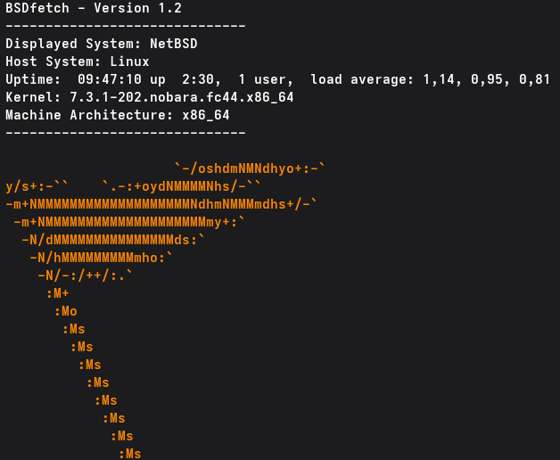
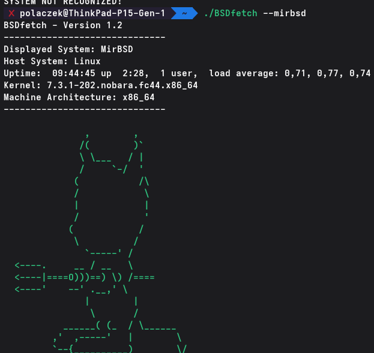

# BSDfetch
BSDfetch is a command made in bash for BSD systems, inspired by commands like screenfetch, fastfetch and neofetch.

# Screenshots



# Installation
Download the Shell Script called bsdfetch and put it into the ~ directory (Sorry Windows and macOS users) and then run (if you aren't in ~ already):
```sh
cd ~
```
After that, we need to convert that script into a command, run:
```sh
chmod +x BSDfetch
```
and after that? You're done!
