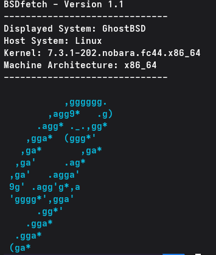

# BSDfetch
BSDfetch is a command made in bash for BSD systems, inspired by commands like screenfetch, fastfetch and neofetch.

# Screenshots



# Installation
Download the Shell Script called bsdfetch and put it into the ~ directory (Sorry Windows and macOS users) and then run (if you aren't in ~ already):
```sh
cd ~
```
After that, we need to convert that script into a command, run:
```sh
chmod +x BSDfetch-v1.1
```
and after that? You're done!

# All commands:
```sh
./BSDfetch-v1.1
./BSDfetch-v1.1 --help (or ./BSDfetch -h)
./BSDfetch-v1.1 --freebsd
./BSDfetch-v1.1 --openbsd
./BSDfetch-v1.1 --netbsd
./BSDfetch-v1.1 --dragonflybsd
./BSDfetch-v1.1 --ghostbsd
./BSDfetch-v1.1 --hardenedbsd
./BSDfetch-v1.1 --nomadbsd
./BSDfetch-v1.1 --midnightbsd
./BSDfetch-v1.1 --bsd/os
./BSDfetch-v1.1 --4.4bsd
```
